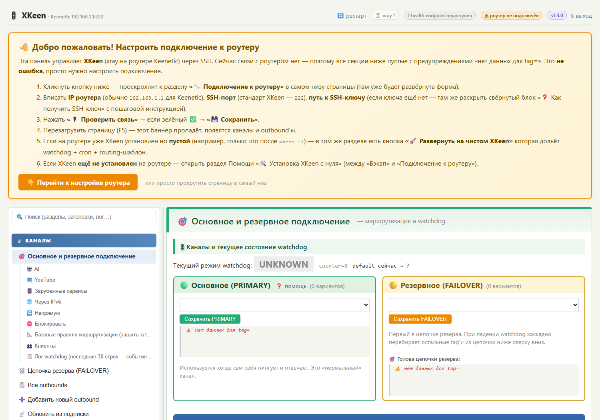
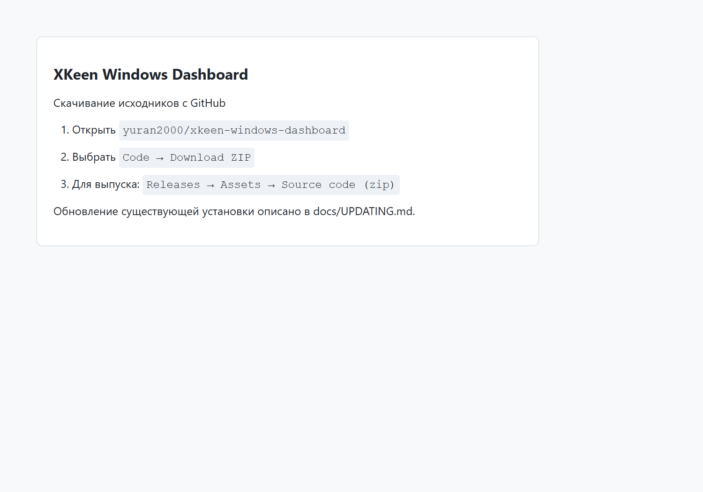
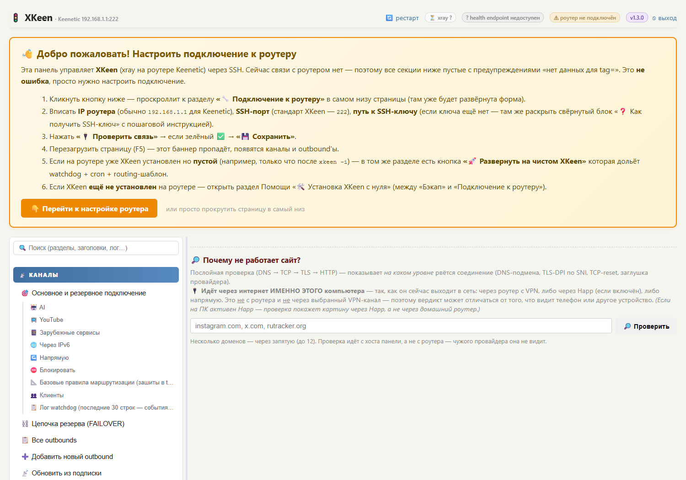
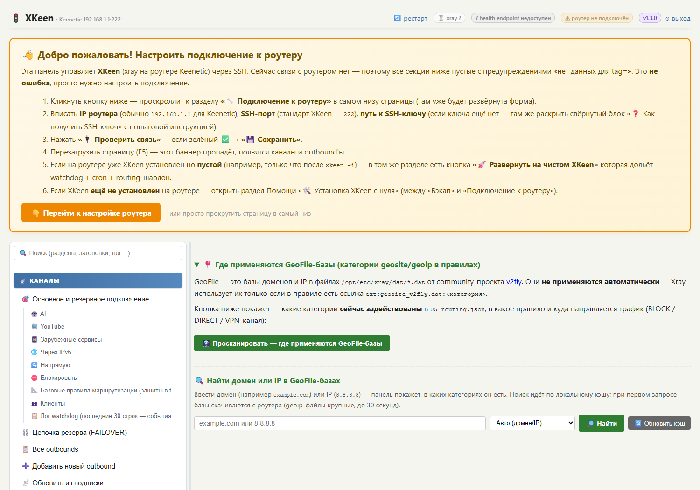

# XKeen Windows Dashboard

Windows-панель управления XKeen на роутере Keenetic: подписки VLESS, каналы
маршрутизации, резервирование, WireGuard-доступы, диагностика и резервные копии.

[Последний выпуск](https://github.com/yuran2000/xkeen-windows-dashboard/releases/latest) ·
[Вопросы и ошибки](https://github.com/yuran2000/xkeen-windows-dashboard/issues) ·
[Инструкция обновления](docs/UPDATING.md) · [MIT](LICENSE)

## Для существующих установок

Адрес проекта остается прежним. Локальные настройки и ключи не входят в публичные
выпуски. Обычное обновление Git-установки — через `update.bat`.
Для старого клона после обслуживания истории может потребоваться разовый переход
через `Recover-Update.bat` с проверенной резервной копией. Подробные шаги для Git
и ZIP приведены в [инструкции обновления](docs/UPDATING.md).

## Возможности

- Основное и резервное подключение с автоматическим уходом по цепочке каналов.
- Отдельные каналы AI, YouTube, зарубежных сервисов и IPv6; списки DIRECT/BLOCK.
- Предпросмотр и обновление VLESS-подписок, группировка серверов и сроки подписок.
- Предупреждение о смене TLS-отпечатка и нестабильных случайных отпечатках.
- Сквозные пробы трафика, обнаружение медленного YouTube и перегрузки Xray.
- Проверка скорости основного YouTube до возврата с резерва; уведомление после
  успешного применения. Интервалы, пороги и цепочки настраиваются в панели.
- Снимки причин сбоя: журналы и состояние соединений до попытки восстановления.
- Применение связанных изменений за один перезапуск Xray с проверкой и откатом.
- Kill-switch политики XKeen и управление клиентами политики.
- Выдача и отзыв WireGuard-доступов, правила доступа, экспорт `.conf`.
- Развертывание структуры на чистом XKeen, создание отсутствующей политики и
  необязательная установка `tcpdump`.
- Проверка доступности сайтов, DNS/TCP/TLS/HTTP-диагностика, поиск по GeoFile.
- Telegram-уведомления, уведомления Windows, ежедневные снимки конфигурации.
- Несколько экземпляров панели с разными портами и роутерами.



## Требования

- Windows 10/11, Python 3.10 или новее, Git for Windows для установки через Git.
- Keenetic с Entware и XKeen; доступ по SSH с ключом.
- Доступ к панели из доверенной локальной сети. Публиковать ее порт напрямую в
  интернете не рекомендуется; для удаленного доступа используется VPN.

Приложение работает на Windows. Установщики, задачи Планировщика, уведомления
Windows и portable-сборка используют платформенные возможности этой системы.

## Первая установка

Если панель уже установлена, перейти к [инструкции обновления](docs/UPDATING.md).

### Установка из ZIP

1. Установить [Python 3.10 или новее](https://www.python.org/downloads/windows/).
   В установщике отметить **Add python.exe to PATH**.
2. Скачать проект через **Code → Download ZIP** и распаковать его, например
   в `C:\xray-dashboard`. Файл `install.bat` должен находиться непосредственно в этой папке,
   а не еще в одной вложенной папке.
3. Запустить **`install.bat`** и дождаться установки компонентов.
   Предложенный свободный порт обычно можно принять нажатием Enter.
4. Задать пароль входа — не меньше 10 символов — и повторить его.
   Символы при вводе не отображаются. Пароль нужно сохранить; он потребуется при входе.
5. Запустить **`start.bat`**, открыть показанный установщиком адрес
   (обычно `http://localhost:5000`) и войти с именем **admin** и заданным паролем.

Локальные настройки создаются автоматически, редактировать код не требуется.
При обычном запуске окно `start.bat` должно оставаться открытым.



Если установка или запуск не удались:

- **`Python not found`:** проверить установку Python и галочку **Add python.exe to PATH**,
  затем заново запустить `install.bat`.
- **Ошибка установки компонентов:** проверить интернет и сохранить текст ошибки.
- **Страница не открывается:** проверить окно `start.bat` и адрес с портом,
  указанные при установке. Сообщение о недоступном роутере до его настройки допустимо.

Для фоновой работы используется `start-bg.bat`. Автозапуск настраивается через
`install_service.bat` с правами администратора; его лучше включать после проверки обычного запуска.

### Установка через Git

Этот вариант удобен для дальнейшего обновления через `update.bat`.
Сначала установить [Git for Windows](https://git-scm.com/download/win).

В PowerShell скачать проект в новую папку:

```powershell
git clone https://github.com/yuran2000/xkeen-windows-dashboard.git C:\xray-dashboard
```

После завершения в `C:\xray-dashboard` должны появиться файлы панели.
Если папка уже существует, не удалять ее: для готовой установки нужен раздел обновления.

Перейти в папку проекта:

```powershell
cd C:\xray-dashboard
```

Затем запустить установку:

```powershell
.\install.bat
```

Установщик проверит компоненты и предложит задать пароль. Остальные шаги первого
запуска совпадают с установкой из ZIP. Если команда `git` не найдена, проверить
установку Git и открыть новое окно PowerShell.

## Подключение к роутеру

В разделе подключения задать адрес Keenetic, SSH-порт, пользователя и путь к
ключу. Для SSH используются штатные средства OpenSSH Windows. Закрытый ключ
должен быть доступен учетной записи, под которой запущена панель.

Встроенная справка описывает подготовку Entware/XKeen, политику `XKeen`, привязку
клиентов, подписки и первоначальное развертывание структуры. Панель показывает
отсутствующие компоненты и предлагает штатные операции установки.

Источник состояния каналов — роутер. Изменения через кнопки сохранения могут
записывать конфигурацию и обновлять watchdog. Перед применением проверяются
входные данные, создаются резервные копии; операции, требующие перезапуска,
проверяют результат и используют откат при поддерживаемом сценарии отказа.

Обновление Windows-файлов само по себе не означает применение всех новых
компонентов на роутере. При баннере отставания структуры используются диагностика
и штатная синхронизация панели. Не прерывать VPN, несущий текущий удаленный сеанс.

## Обновление

```powershell
cd C:\xray-dashboard
.\update.bat
```

Обновление получает `main`, сохраняет проверенную копию исходников и настроек,
проверяет зависимости и синтаксис до перезапуска панели. Ошибка загрузки оставляет
текущий процесс работающим. Пользовательские ветки и незавершенные операции Git
автоматически не исправляются. Для старой истории и локальных изменений
предусмотрен отдельный подтверждаемый переход.

Подробности и восстановление: [docs/UPDATING.md](docs/UPDATING.md).

## Диагностика

Раздел «Почему не работает сайт?» проверяет доступ с компьютера панели.
Маршрут этого компьютера может отличаться от маршрута клиента на телефоне.
Успешный TCP-контакт не доказывает передачу данных или достаточную скорость:
для каналов предусмотрены отдельные сквозные проверки и замер YouTube.



GeoFile-раздел показывает категории доменов/IP и использование баз в правилах.



## Несколько экземпляров

Каждая папка установки содержит собственные настройки и порт. Стандартный порт
5000 использует задачу `XrayDashboard`; другой порт — `XrayDashboard-<порт>`.
Фоновые задачи и перезапуск панели относятся к выбранному экземпляру.

## Безопасность и обратная связь

Не публиковать `config_local.py`, `runtime_settings.json`, ключи, подписки,
реестр WireGuard-клиентов и резервные копии. Перед приложением журналов к Issues
удалить токены, адреса личных узлов и другие конфиденциальные значения.

[Сообщить об ошибке или задать вопрос](https://github.com/yuran2000/xkeen-windows-dashboard/issues).
Правила сообщений об уязвимостях — [SECURITY.md](SECURITY.md), вклад в проект —
[CONTRIBUTING.md](CONTRIBUTING.md), устройство кода — [docs/ARCHITECTURE.md](docs/ARCHITECTURE.md).

## Лицензия

[MIT](LICENSE). Уведомления о сторонних компонентах —
[THIRD-PARTY-NOTICES.md](THIRD-PARTY-NOTICES.md).
